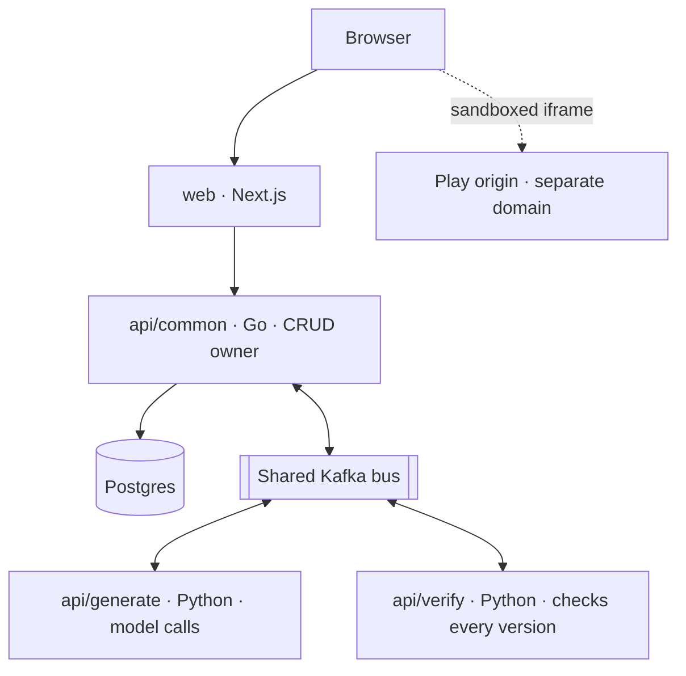

# Consoless

> **Describe it. Play it. Share it.**

Consoless is an open-source platform where anyone can make a game by describing it. You type "a falling-block puzzle on a handheld with a green screen", pick a look, and play the result in your browser within minutes. Each follow-up message ("make the blocks fall faster", "switch to an arcade cabinet") edits the same game and saves a new version. Finished games can be published to a public link, played by anyone and remixed.

The platform has two layers:

- **An open-source game engine** (MIT): a TypeScript runtime, one game format and console styles defined as data. Every generated game is written against it, so you can read the code, change it and keep building locally.
- **A hosted service** run by CueLABS™: it turns prompts into games, checks and previews them, and stores, versions and publishes them.


---

## Roadmap

| Stage | What you can make |
| --- | --- |
| **1. Retro & 2D** | Puzzles, platformers, shooters and top-down adventures in a console style (handheld, 8-bit and 16-bit home console, arcade cabinet, modern), played in the browser |
| **2. 3D** | Games with scenes, cameras, lighting, physics, models and characters, played in the browser |
| **3. Installable** | Any Consoless game packaged as a desktop app for Windows, macOS and Linux |

### Where things stand

The repository is in **Phase 0**: the earlier console-rental prototype has been retired, and the new direction is recorded in [`docs/decisions.md`](docs/decisions.md) (C-1 to C-4).

- **Design first.** The landing page, Studio, Arcade, My Games and console-style frames are designed in Figma before any new UI is built (C-4). Until then the web app keeps the prototype's layouts with updated copy.
- **Architecture.** The proposed system is in [`docs/system-design.md`](docs/system-design.md) (open [`docs/system-design.html`](docs/system-design.html) for the diagrams). It is a draft awaiting ratification (S-1 to S-15).

---

## Architecture (proposed)



- `api/common` owns all data: users, projects, versions, publishing and leaderboards.
- `api/generate` makes every model call (Gemini through Vertex AI), applies the content and IP policy, and moderates games before publishing.
- `api/verify` type-checks and runs each version headlessly before anyone sees it. It holds no model credentials.
- Generated games only ever run on a separate play origin, never on the main site.

See the [system design](docs/system-design.md) for services, data ownership, flows and open questions.

---

## Repository structure

| Path | Contents |
| --- | --- |
| [`web/`](web/) | Next.js App Router app: the landing page (`/`), the hub (`/dashboard`) and the leaderboard (`/dashboard/leaderboard`) |
| [`docs/`](docs/) | Decisions register and system design |
| [`.cuelabs/project.yaml`](.cuelabs/project.yaml) | CueLABS project manifest: which surfaces are active or planned |

`engine/` and the `api/` services are planned; they are created when their phase starts.

---

## Getting started

### Prerequisites

- **Node.js** 24 (see [`web/.nvmrc`](web/.nvmrc))
- **npm**

### Run locally

```bash
git clone https://github.com/cuesoftinc/consoless.git
cd consoless/web
npm ci
NEXT_PUBLIC_TEST_MODE=true npm run dev
```

Open `http://localhost:3000`. In TEST_MODE, "Continue with Google" signs you in as a local test user without contacting Google.

### Test

```bash
cd web
npm run lint
npm run typecheck
npm test
npm run test:e2e
```

---

## Contributing

Contributions to the engine, console styles and the generation pipeline are welcome. Read [CONTRIBUTING.md](CONTRIBUTING.md) and the [Code of Conduct](CODE_OF_CONDUCT.md) first. Report security issues as described in [SECURITY.md](SECURITY.md).

Questions about the hosted service go to [cuelabs.cuesoft.io](https://cuelabs.cuesoft.io).

## License

[MIT](LICENSE).
