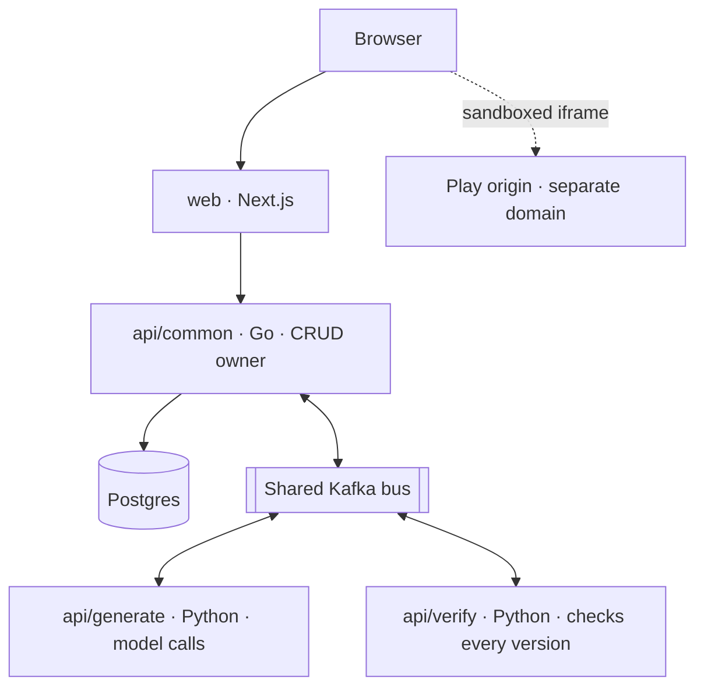

# Consoless — Overview

Consoless is an open-source platform where anyone can make a game by
describing it. You type "a falling-block puzzle on a handheld with a green
screen", pick a console style, and play the result in your browser. Each
follow-up message edits the same game and saves a new version. Finished
games can be published to a public link, played by anyone and remixed.

The platform has two layers:

- **An open-source game engine** (MIT): a TypeScript runtime, one game
  format, and console styles defined as data.
- **A hosted service** run by CueLABS™: it turns prompts into games, checks
  and previews them, and stores, versions and publishes them.

## Where things stand

- **[Current]** The repository holds the web app (`web/`) and the docs. The
  web app runs in TEST_MODE against an in-app mock server. It carries the
  design tokens, the component library, the landing page, sign-in, My Games
  and Settings.
- **[Decided C-5]** The web is being rebuilt from the Figma designs in
  stages: foundations, components, the landing page, then the dashboards.
- **[Decided S-1]** The engine and the backend services are planned and are
  created when their phase starts. Nothing in `api/` or `engine/` exists
  yet.

## Architecture

- `api/common` owns all data: users, projects, versions, publishing and
  leaderboards.
- `api/generate` makes every model call, applies the content and IP policy,
  and moderates games before publishing.
- `api/verify` type-checks and runs each version headlessly before anyone
  sees it. It holds no model credentials.
- Generated games only ever run on a separate play origin, never on the main
  site.

This is the target design. See [system-design.md](system-design.md) for the
services, data ownership, flows and migration plan.

## Documentation

> Published site: **https://cuesoft.gitbook.io/consoless**, Git-synced from
> this folder on every merge to `main`.

- [setup.md](setup.md) — run the web app locally and run its checks
- [decisions.md](decisions.md) — the ratification register; other docs defer
  to it
- [design.md](design.md) — the design contract: tokens, type, components,
  microinteractions, accessibility and prototype journeys
- [pages.md](pages.md) — every designed screen, by page, with requirement
  coverage
- [system-design.md](system-design.md) — the ratified system design (S-1 to
  S-26)

The product requirements, roadmap, architecture, data model, API and
deployment pages are written as their phases start.
