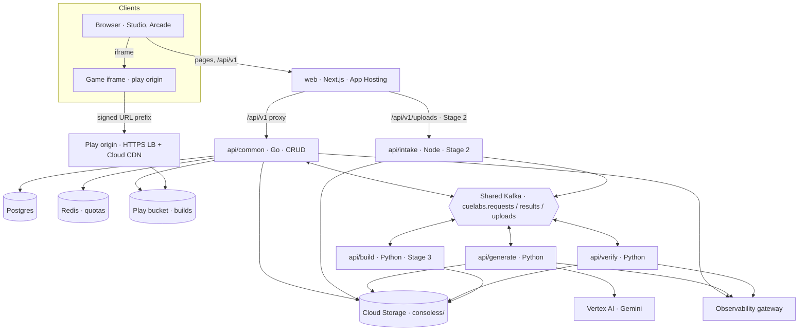
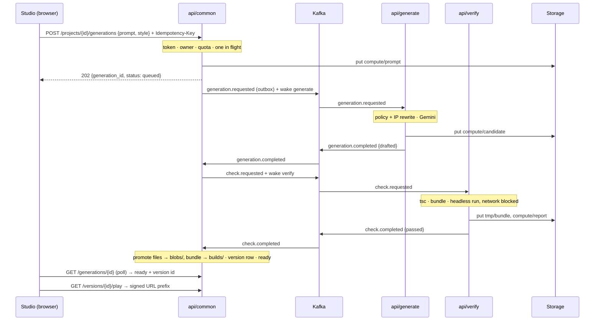
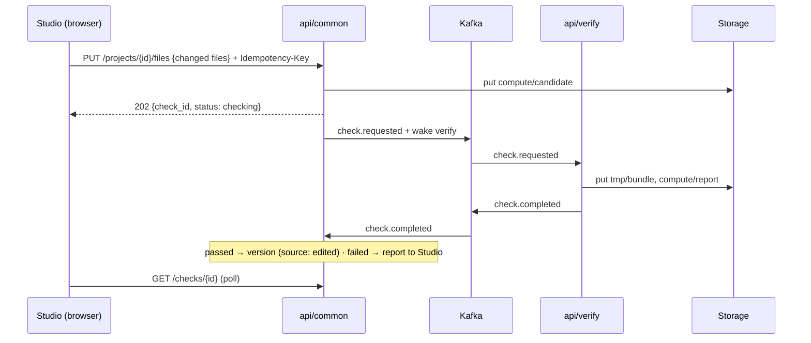
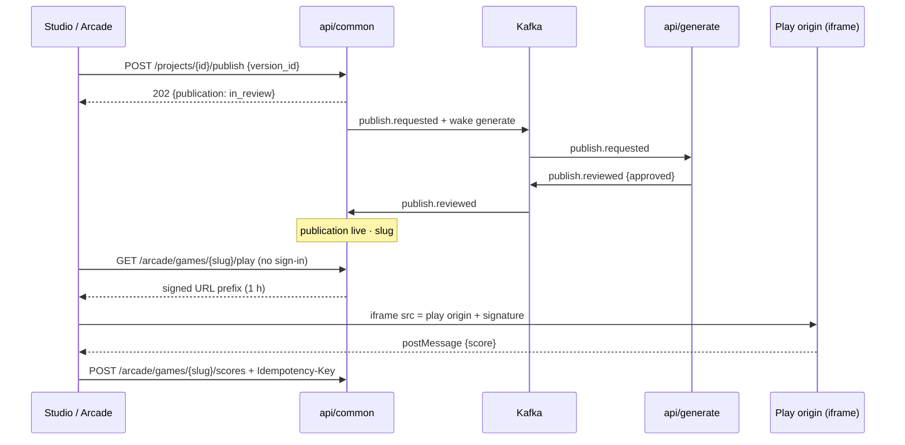

# Consoless — System Design

> **Status:** [Ratified] v1 — signed off 2026-10-30; decisions S-1 to S-23 are
> recorded in `docs/decisions.md`.
> This document is the source for `docs/architecture.md`,
> `docs/data-model.md` and `docs/api.md`. None of them exist yet; each is
> written from the matching section here (§12).
> It keeps every ratified product decision in `docs/decisions.md` except
> those listed in §13 as needing sign-off: P-07, P-09, P-11 and P-12 change
> because the rental product they describe is gone, and P-17 is new.
> New decisions are listed in §13 as S-1 to S-15.
> The requirements come from the Consoless PRD: CON-001 to CON-014, the
> delivery stages, and §§4–8.

The language rule, applied to Consoless:

- **Go (`api/common`) does CRUD only.** It owns Postgres and every durable
  object prefix. It stores what the other services decide and never decides
  a value itself.
- **Python makes every decision.** `api/generate` makes every model call:
  generation, refinement, the prompt policy and IP rewrite, and publish
  moderation. `api/verify` gives the pass or fail verdict on every version.
- **A Node gateway stays thin.** `api/intake` (Stage 2) checks the upload
  ticket and the file, and hands the file off.
- **Serverless functions** are not used: Consoless has no probe-style
  endpoints.

Services are named by what they do (`api/<function>`). They hand work to
each other over the shared CueLABS™ Kafka bus, carrying pointers rather than
data. The one synchronous internal call is the data-free wake-up.

## 1. Why redesign — audit of the current design

What was audited: the Consoless PRD, `README.md`, `docs/decisions.md`,
`.cuelabs/project.yaml` and the prototype under `web/src` on `main`
(`cc2c3ee`).

| # | Finding | Evidence | Consequence |
| --- | --- | --- | --- |
| F1 | **The prototype builds a different product.** | `README.md` describes renting consoles, streaming and a crypto and fiat wallet. `web/src/models/types.ts` defines `Session`, `Transaction` and `ConsoleModel`. `controllers/app-state.tsx` holds `walletBalance`. | None of CON-001 to CON-014 has code. Phase 0 removes the rental surfaces; this design describes everything that replaces them. |
| F2 | **The web server makes AI calls with a consumer key.** | `models/repositories/gemini-proxy.ts` sends `x-api-key: GEMINI_PROXY_API_KEY` to `gemini-proxy.cuesoft.io` from Next.js route handlers. | This breaks the language rule (decisions belong in Python) and the delivery canon, which requires Vertex AI over ADC with no consumer keys in the cloud. The PRD asks for this to be confirmed or replaced. |
| F3 | **The cost guard is per instance and anonymous.** | `lib/request.ts` `guardPaidRoute`: a same-origin check plus an in-memory `hits` map allowing 20 calls a minute. There is no sign-in. | Every Next.js instance has its own counter, and anyone can spend model budget. PRD §5 (cost control) requires sign-in and per-user quotas in a shared store. |
| F4 | **Sign-in is an email form.** | `auth/provider.ts` `signIn(email)`, backed only by `test-mode-provider.ts`. | The organization's policy and PRD §4.2 allow Google sign-in only, verified by the backend. |
| F5 | **Generated code has nowhere safe to run.** | There is no second origin, no iframe sandbox and no CSP anywhere in `web/`. | CON-004 and PRD §7 require generated code to run away from the user's session. Running it on `consoless.cuesoft.io` would expose the sign-in token to every game. |
| F6 | **Nothing persists.** | All state is React state (`app-state.tsx`) or mock seeds (`mocks/seed.ts`). There is no backend (`project.yaml`: `backend: planned`). | Versions, publishing, remixes and leaderboards (CON-002, 006, 008) need an owner and a store. |
| F7 | **The decisions register describes rentals.** | P-07 "absolute for bookings", P-12 "the wallet is mock; 16 or older", P-09 and P-11 `n/a`, and no P-17. | The parameters need new values. Each is listed in §13 for sign-off. |

**What is solid and carries forward:** the Next.js app on App Hosting with
its token layer (the dark "Cyber-Gamer" palette, P-04), the TEST_MODE and
mock-API pattern (which becomes the contract, §7), the leaderboard screen
(CON-008), the input-bounding helpers in `lib/ai.ts` (as a pattern for
`api/common`'s validators), the CI workflow, and the community files.

## 2. Design drivers

| # | Driver | Design response |
| --- | --- | --- |
| D1 | **Untrusted generated code must never reach a user's session or our credentials.** | Games are served only from a separate registrable domain (the play origin) inside `<iframe sandbox="allow-scripts">`, with a CSP limiting `connect-src` to approved asset hosts. `api/verify` runs candidates in a headless browser with all network blocked, and holds no model credentials. |
| D2 | **Time to first playable.** Users sit and wait. | The Studio polls a status row (`queued → generating → checking → ready`). Every publish wakes the consumer it is for. Retries are bounded at 3 attempts. Messages are pointers, so hops cost milliseconds. |
| D3 | **First-try success** is the core quality measure. | The model writes against a documented engine API. Every version is type-checked and run headlessly before anyone sees it. A failed check sends the error report back to the model. |
| D4 | **AI cost stays bounded.** | Generation requires Google sign-in. `api/common` checks per-user quotas and a limit of one in-flight generation per project in shared Redis before any message is queued. |
| D5 | **One game format from Stage 1 to Stage 3.** | A version is a manifest plus a `path → sha256` file tree. The browser runtime, the local engine and desktop builds read the same tree, so a Stage 1 game exports in Stage 3 without being rebuilt. |
| D6 | **Versions and remixes are cheap and permanent.** | Files are stored once, content-addressed (`blobs/<sha256>`). A version or a remix copies a tree, not bytes. |
| D7 | **IP and content safety.** | `api/generate` applies the content policy and IP rewrite before generating and moderates before publishing. `api/common` stores reports and takedowns. |
| D8 | **Open source and self-hostable.** | The engine, runtime, game format and styles are MIT. Every managed dependency has a single-container equivalent in compose. Self-hosters bring their own model key. |
| D9 | **Prompts and code stay private.** | Prompts and code travel only by `data_ref` in the product's own storage prefix, never in logs or on the bus. Analytics carry counts only. |

## 3. Architecture overview



## 4. Services

| Unit | Lang | Role | Responsibility | Owns | Port |
| --- | --- | --- | --- | --- | --- |
| `web` | Next.js | Client | Landing page, Studio (chat, preview, style picker, versions, code view), Arcade, My Games, the privacy page. Proxies `/api/v1` to the API. Hosts the game iframe | Nothing | 3000 |
| `api/common` | Go | CRUD owner | Users (Firebase ID tokens, Google only), projects, versions, generation and check status rows, attempt counts, publishing, remix, scores and leaderboards, reports and takedowns, quotas, outbox, signed play URLs, project export, promoting checked files and bundles to durable prefixes, deletion, sweeps | Postgres, durable storage prefixes, play bucket | 8080 |
| `api/generate` | Python | Processing (AI) | Prompt policy and IP rewrite, generation, refinement (whole game in Stage 1, per-file patches in Stage 2), publish moderation, asset generation (Stage 2). The only holder of Vertex AI access | Nothing | 8081 |
| `api/verify` | Python | Processing (checks) | Type-checks each candidate against the engine types, bundles it, runs it headlessly for a few seconds with synthetic input, and decides pass or fail with a report. Checks user code edits the same way | Nothing | 8082 |
| `api/intake` | Node | Gateway (Stage 2) | Verifies upload tickets, checks the file against the ticket, strips metadata, writes to `tmp/` and publishes a pointer | Nothing | 8083 |
| `api/build` | Python (S-20) | Processing (Stage 3) | Packages a version into desktop installers for Windows, macOS and Linux | Nothing | 8084 |

**Retired:** the Next.js AI route handlers (`/api/v1/ai/lobby`,
`/api/v1/ai/coaching`), `gemini-proxy.ts`, the env vars `GEMINI_PROXY_URL`
and `GEMINI_PROXY_API_KEY`, and the in-memory `guardPaidRoute` limiter.
Phase 0 also removes the rental, streaming and wallet screens.

**Why these boundaries:**

- **`generate` and `verify` are separate services, not two deployments of
  one.** This meets two of the split criteria in `method.md`:
  *credentials differ* and *isolated failure domains*. `verify` executes
  untrusted, model-written code; if it held Vertex credentials, one
  malicious game could spend the model budget or read them. It also needs a
  different image (Node toolchain plus headless Chromium, about 1 GiB)
  and more memory.
- **The retry loop runs through `api/common`, not directly between
  `generate` and `verify`.** The shared bus has no processing-to-processing
  lane, and the attempt count is a lookup-then-write on the owner's row. On
  a failed check, `common` sends a new request carrying the failed
  candidate and the report.
- **Moderation lives in `generate`.** It uses the same model access, policy
  text and vocabulary. It runs as the same deployment: publish volume is low
  and nobody is blocked by it for long. Splitting moderation into a second
  deployment is recorded as S-2's alternative.
- **`api/build` (Stage 3) is its own service.** Code-signing credentials
  must not sit next to model credentials or untrusted code, and packaging
  toolchains are heavy.
- **`api/intake` (Stage 2) exists only because clients upload assets.**
  Stage 1 has no uploads, so it is not built until then.

## 5. Data architecture

### 5.1 Stores and ownership

| Store | Holds | Written by | Read by | Source of truth? |
| --- | --- | --- | --- | --- |
| Postgres (Aiven, database `consoless`) | Users, projects, versions and their file trees, generations, checks, publications, scores, reports, quotas config, outbox | `api/common` | `api/common` | Yes |
| Redis (shared Aiven, own `REDIS_DB`) | Per-user generation quotas, per-project in-flight locks, score rate limits | `api/common` | `api/common` | No; losing it resets the counters |
| Cloud Storage `consoless/compute/` | Claim-check payloads: prompt and context, candidate file sets, check reports, moderation inputs | `api/common`, `api/generate`, `api/verify` | The same three | No; deleted after one day |
| Cloud Storage `consoless/tmp/` | Bundles awaiting promotion; Stage 2 uploads awaiting checks | `api/verify`, `api/intake` | `api/common` | No; deleted after one day |
| Cloud Storage `consoless/blobs/` | Project files, content-addressed by sha256 | `api/common` (promotes from `compute/`) | `api/common`; `api/generate` and `api/verify` by pointer | Yes, with the tree in Postgres |
| Play bucket (dedicated, S-6) `builds/` | Playable bundles, one per version | `api/common` (promotes from `tmp/`) | The play origin (Cloud CDN, signed requests only) | Rebuildable from blobs |
| Cloud Storage `consoless/exports/` (Stage 3) | Desktop installers | `api/build` | `api/common` (signed download URLs) | No; rebuildable |

### 5.2 Schema `api/common` needs

| Table | Key columns | Why |
| --- | --- | --- |
| `users` | `id`, `firebase_uid`, `email`, `display_name`, `creator_attested_at`?, `created_at` | Google identity (tier 0); the one-time 16-or-older attestation required before creating (tier 1, S-15) |
| `projects` | `id`, `owner_id`, `title`, `style_id`, `engine_version`, `head_version_id`, `remixed_from_version_id`, `deleted_at` | CON-002, CON-003, CON-006 |
| `versions` | `id`, `project_id`, `parent_id`, `source` (`generated`/`edited`/`remixed`), `manifest` jsonb, `tree` jsonb (`path → sha256`), `bundle_key`, `generation_id`, `created_by` | One immutable row per change. The tree makes compare, restore and remix copies, not file copies |
| `generations` | `id`, `project_id`, `base_version_id`, `request_id`, `status`, `attempt`, `max_attempts`, `reason_code`, `prompt_ref`, `candidate_ref`, `report_ref`, `requested_at`, `updated_at` | The status row the Studio polls (CON-001). Holds what each request was built from, so the sweep can re-send it |
| `checks` | `id`, `project_id`, `generation_id`?, `request_id`, `status`, `report_ref`, `bundle_ref` | User edits are checked without a generation (CON-007) |
| `publications` | `id`, `project_id`, `version_id`, `slug`, `status` (`in_review`/`live`/`rejected`/`taken_down`), `reason_code`, `published_at` | CON-006; moderation status |
| `scores` | `id`, `publication_id`, `user_id`, `value`, `submitted_at`, unique (`publication_id`, `user_id`, `idempotency_key`) | CON-008 |
| `reports` | `id`, `publication_id`, `reporter_id`?, `reason`, `status` | PRD §7: report and takedown |
| `outbox` | `id`, `type`, `key`, `payload`, `created_at`, `sent_at` | Outbox pattern for every event `common` publishes |
| `processed_messages` | `message_id`, `processed_at` | Idempotent consumption |

Row-level security keys every user-owned table on `owner_id` or `user_id`.
Published rows are readable to everyone through views that expose only the
public columns.

### 5.3 Queue events

The shared bus contract (lanes, envelope, limits, consumer groups and
operations) is `$cuelabs-delivery-standard`'s `shared-messaging.md`. This
table lists only Consoless's events. Every `data` value is identifiers,
enums, counts and timestamps. Prompts, code and reports always go by
`data_ref` under `consoless/compute/`.

| Event | Lane | Key | Producer → consumers |
| --- | --- | --- | --- |
| `consoless.generation.requested` | `cuelabs.requests` | project id | `common` (outbox) → `generate` |
| `consoless.generation.completed` (`outcome`: `drafted`, `refused`, `failed`) | `cuelabs.results` | project id | `generate` → `common` |
| `consoless.check.requested` | `cuelabs.requests` | project id | `common` (outbox) → `verify` |
| `consoless.check.completed` (`passed`, `report_ref`, `bundle_ref`) | `cuelabs.results` | project id | `verify` → `common` |
| `consoless.publish.requested` | `cuelabs.requests` | project id | `common` (outbox) → `generate` |
| `consoless.publish.reviewed` (`approved`, `reason_code`) | `cuelabs.results` | project id | `generate` → `common` |
| `consoless.asset.received` (Stage 2) | `cuelabs.uploads` | project id | `intake` → `common` |
| `consoless.build.requested` / `.completed` (Stage 3) | `cuelabs.requests` / `cuelabs.results` | project id | `common` ↔ `build` |

Consumer groups: `consoless-common`, `consoless-generate`,
`consoless-verify` (and `consoless-build` in Stage 3). Kafka user:
`consoless`. Keying by project id keeps one project's steps in order.
Expected rate is well under 1 KiB/s (§9), so joining the bus fits its
throughput limit.

## 6. Key flows

### 6.1 Prompt to playable game (CON-001, CON-004)



- **Failed check:** if `attempt < max_attempts` (3), `common` sends
  `generation.requested` again with the failed candidate and report refs,
  and sets the status to `retrying`. Otherwise the status becomes `failed`
  with a `reason_code` the Studio shows next to a Retry button.
- **Refused prompt:** `generate` returns `outcome: refused` with a policy
  reason code. `common` marks the generation `refused` and refunds the quota
  unit.
- **Overdue work:** the `resend-overdue` sweep queues a request again once
  when it is more than 3 minutes overdue (new message id, same
  `request_id`), then fails it. A bus power-off costs a delay, not lost
  work.
- **Refinement (CON-002)** is the same flow with `base_version_id`. In
  Stage 1, `generate` returns the whole game; in Stage 2 it returns changed
  files only and `verify` checks the merged tree.

### 6.2 Code edit to new version (CON-007)



- A failed edit never becomes a version. The Studio shows the type or
  runtime errors from the report and keeps the user's text.
- Restoring an old version creates a new head pointing at the same tree; no
  check is needed because the bundle already exists.

### 6.3 Publish, play and score (CON-006, CON-008)



- The game runtime never calls the API. The engine's score call posts a
  message to the parent page. The Arcade page checks `event.origin` against
  the play origin and submits the score with the signed-in player's token.
- Anonymous players can play but not submit scores.
- Remix (`POST /arcade/games/{slug}/remix`) creates a project whose head
  version copies the published tree and records `remixed_from_version_id`.

### 6.4 Delete and export (CON-014, CON-007)

- `GET /projects/{id}/export` streams a zip built from blobs: the manifest,
  the files and a `package.json` pinning the engine version, so it runs with
  the local engine.
- `DELETE /projects/{id}` sets `deleted_at`, takes down publications,
  deletes the `builds/` objects at once, and leaves blobs to the
  `gc-blobs` sweep, which deletes any blob no live tree references.
  `DELETE /me` does this for every project and then deletes the user row.

### 6.5 Configuration and scheduled jobs

Configuration flows outward. Each `generation.requested` carries the style
id, engine version, attempt number and refs; `generate` and `verify` ship
the engine packages, style files and policy text for each supported engine
version inside their images. Neither ever queries `common`.

Sweeps are Cloud Scheduler jobs calling `POST /internal/jobs/<name>` on
`api-common`:

| Job | Every | Does |
| --- | --- | --- |
| `resend-overdue` | 1 min | Re-sends overdue generations and checks once, fails them after that, and wakes consumers while work is in flight |
| `sweep-compute` | 1 h | Deletes `compute/` and `tmp/` objects older than a day (backed by a bucket lifecycle rule) |
| `gc-blobs` | 1 day | Deletes blobs no live version references |

## 7. API surface

**Hosts:**

- `consoless.cuesoft.io` serves the app. The browser calls the relative
  path `/api/v1`, which the web server proxies to `api-common` (`API_URL`,
  the delivery canon); in Stage 2, `/api/v1/uploads` goes to `api-intake`.
- The play origin, `play.cuesoft.io` (S-6), serves only game bundles.

**Protocol:** HTTP/JSON, the organization's error envelope, cursor
pagination, and `Idempotency-Key` on generations, edits, publishing, scores
and uploads. Rate limits return `429` with `Retry-After`. Cross-tenant
access returns `404`.

**Initial surface:**

- `POST /projects`, `GET /projects`, `GET/PATCH/DELETE /projects/{id}`
- `POST /projects/{id}/generations`, `GET /generations/{id}`
- `PUT /projects/{id}/files`, `GET /checks/{id}`
- `GET /projects/{id}/versions`, `GET /versions/{id}`,
  `GET /versions/{id}/files/{path}`, `POST /versions/{id}/restore`,
  `GET /versions/{id}/play`
- `POST /projects/{id}/publish`, `GET /arcade/games`,
  `GET /arcade/games/{slug}`, `GET /arcade/games/{slug}/play`,
  `POST /arcade/games/{slug}/remix`, `GET/POST /arcade/games/{slug}/scores`,
  `POST /arcade/games/{slug}/reports`
- `GET /projects/{id}/export`, `GET /me`, `DELETE /me`

**The web mock is the contract.** Phase 0 deletes the AI mocks
(`/api/mock/v1/ai/*`). Phase 1 adds mocks for every route above under
`web/src/app/api/mock/v1/` first; the Go handlers then implement them.

## 8. Security and tenancy

| Concern | Control |
| --- | --- |
| User auth | The Firebase Authentication SDK (shared identity project, Google only) in the browser. `api/common` verifies ID tokens with ADC and rejects any `sign_in_provider` other than `google.com` |
| Authorization and tenancy | Ownership checks in `common`'s service layer, plus Postgres RLS on every user-owned table. Cross-tenant access returns `404` |
| Generated code | Runs only on the play origin, in `<iframe sandbox="allow-scripts">` (no `allow-same-origin`), with a CSP of `default-src 'self'`, `connect-src` limited to the approved asset hosts, and `frame-ancestors` limited to the app origin. A Permissions-Policy allows only `gamepad` and `fullscreen`. Every bundle response also carries `Content-Security-Policy: sandbox allow-scripts`, so a game opened directly (outside the iframe) still runs with an opaque origin and cannot read `cuesoft.io` cookies or storage. No Cuesoft site may set a cookie with `Domain=cuesoft.io` |
| Play bucket access | No public objects. Cloud CDN signed URL prefixes are minted only by `common`: one hour for drafts (owner only) and for published games |
| Headless checks | `api/verify` runs Chromium with every request except its local bundle server blocked (route interception plus host-resolver rules), and a non-root user. Its service account can read `compute/` and write `tmp/` only. It holds no Vertex access |
| Machine identity | One Kafka user (`consoless`). Per-service service accounts with storage IAM per prefix: `generate` reads and writes `compute/`; `verify` reads `compute/` and writes `tmp/`; only `common` writes `blobs/` and the play bucket. `run.invoker` grants exist for wake-ups only |
| Model credentials | Vertex AI over ADC on `api/generate`'s service account; no API keys in the cloud. Self-host: a bring-your-own key in `generate`'s environment only |
| Prompt injection | Prompts are data in the model request, never instructions to tools. `generate` has no tools that act; its output is files, and `verify` judges them |
| IP and content | Policy pass before generation; moderation before publishing; reports with takedown by `admin` users |
| Abuse and cost | Per-user daily generation quota, one in-flight generation per project, score submission rate limits, all in Redis, enforced before any message is sent |
| Privacy | Prompts and code never appear in logs, spans or analytics. Analytics carry counts only. Export and full deletion are in §6.4 |
| Secrets | Doppler `stg`. Names only in code and docs |

## 9. Reliability, failure modes, and capacity

**Budgets** (design targets; the PRD sets numeric targets after 90 days of
baseline data):

- Time to first playable: p50 ≤ 60 s, p95 ≤ 150 s.
- Status-poll and CRUD API: p95 ≤ 300 ms.
- A check takes at most 20 s, of which at most 5 s is the headless run.

| Failure | What happens |
| --- | --- |
| Shared bus powered off or unreachable | Outbox rows wait. The Studio shows "queued". `resend-overdue` re-sends once the bus returns and fails the generation (with refund) after 10 minutes. The bus has no SLA (§15 Q11) |
| Vertex AI errors or times out | `generate` retries with backoff, then returns `outcome: failed` with `reason_code: model_unavailable`. The quota is refunded |
| Model writes code that never passes | Three attempts, then `failed` with the last report. First-try success is measured |
| Candidate hangs or loops in the browser | `verify` kills the page at the run limit, and the report records a timeout |
| A consumer is asleep | Wake-ups from the publisher, plus re-wakes from the sweep while work is in flight |
| Duplicate or late result | Ignored by `request_id`; the first result wins |
| Redis lost | Counters reset; nothing else is affected |
| Play CDN outage | Previews and the Arcade fail to load; the Studio and versions keep working |

**Who watches it:** OTLP traces, logs and metrics from every service go to
the observability gateway. Alerts fire on generation failure rate,
time-to-first-playable p95 and overdue work.

**Capacity sketch** (assumed early load: 1,000 generations a day, peak 10
a minute):

- Bus traffic is about 6 messages of under 1 KB each per generation, so the
  peak is under 1 KiB/s against the bus's 250 KiB/s.
- `api/generate` instances are mostly waiting on I/O, so two instances
  cover the peak.
- `api/verify` needs 2 vCPU and 4 GiB per instance for Chromium. At about
  20 s per check, two instances handle about 6 checks a minute, so the peak
  queues briefly.
- Storage: a Stage 1 game is under 1 MB of source and bundle. With
  content addressing, 10,000 projects of 10 versions each come to a few GB.

## 10. Deployment topology

| Unit | Runs as (cloud) | Scaling |
| --- | --- | --- |
| `web` | Firebase App Hosting (`rootDirectory: /web`), behind Cloudflare | Managed |
| `api-common` | Cloud Run service; CPU always allocated (it consumes) | Min 0, max 2; woken by HTTP, wake-ups and sweeps |
| `api-generate` | Cloud Run service; CPU always allocated | Min 0, max 2; woken by `common` |
| `api-verify` | Cloud Run service; 2 vCPU and 4 GiB | Min 0, max 2; woken by `common` |
| `api-intake` (Stage 2) | Cloud Run service | 0 to 5; request-driven |
| `api-build` (Stage 3) | To be decided (§15) | — |
| Play origin | External HTTPS load balancer, a backend bucket with Cloud CDN and signed requests, and custom response headers (the CSP) | Managed |
| Sweeps | Cloud Scheduler → `POST /internal/jobs/<name>` | Created paused until each handler ships |

All units are provisioned in the Pulumi IaC stack.

**Self-host equivalents:** compose and Helm run Postgres, Redis, a
single-node Kafka broker with the three lane names, and MinIO (the `s3`
storage driver). `api/common` serves the play files itself on a second
listener with HMAC-signed paths, at a separate host and port (`PLAY_URL`).
Self-hosters bring their own Gemini key.

**Environment variables:**

| Service | Variables |
| --- | --- |
| All | `APP_ENV`, `PORT`, `LOG_LEVEL`, `OTEL_SERVICE_NAME`, `OTEL_EXPORTER_OTLP_ENDPOINT`, `OTEL_EXPORTER_OTLP_HEADERS`, `KAFKA_BROKERS`, `KAFKA_USERNAME`, `KAFKA_PASSWORD`, `KAFKA_SSL_CA`, `STORAGE_DRIVER`, `STORAGE_BUCKET`, `STORAGE_PREFIX` |
| `common` | `DATABASE_URL`, `DATABASE_POOL_MAX`, `REDIS_HOST`, `REDIS_PORT`, `REDIS_USERNAME`, `REDIS_PASSWORD`, `REDIS_TLS`, `REDIS_DB`, `REDIS_KEY_PREFIX`, `GOOGLE_CLOUD_PROJECT`, `CORS_ORIGINS`, `WEB_URL`, `PLAY_URL`, `PLAY_BUCKET`, `PLAY_SIGNING_KEY_NAME`, `PLAY_SIGNING_KEY`, `WAKE_GENERATE_URL`, `WAKE_VERIFY_URL`, `SCHEDULER_AUDIENCE`, `SCHEDULER_INVOKER_EMAIL` |
| `generate` | `GOOGLE_CLOUD_PROJECT`, `VERTEX_LOCATION`, `GENERATE_MODEL`, `WAKE_COMMON_URL`; self-host only: `GEMINI_API_KEY` |
| `verify` | `CHECK_RUN_SECONDS`, `WAKE_COMMON_URL` |
| `web` | `API_URL`, `NEXT_PUBLIC_WEB_URL`, `NEXT_PUBLIC_PLAY_URL`, `NEXT_PUBLIC_FIREBASE_API_KEY`, `NEXT_PUBLIC_FIREBASE_AUTH_DOMAIN`, `NEXT_PUBLIC_FIREBASE_PROJECT_ID`, `NEXT_PUBLIC_TEST_MODE` |

**Retired:** `GEMINI_PROXY_URL`, `GEMINI_PROXY_API_KEY`.

## 11. Repository layout

```
engine/                     MIT TypeScript workspace (S-13)
  runtime/                  loop, input, rendering (WebGL2/WebGPU), audio
  format/                   game manifest + file-tree JSON Schemas, validators
  styles/                   console styles as data (resolution, palette, frame, input map, sound)
  cli/                      local run and build of an exported project
api/
  common/                   Go · CRUD owner · contract/ (event JSON Schemas)
  generate/                 Python · model calls, policy, moderation
  verify/                   Python · tsc, bundle, headless run (Node + Chromium in image)
  intake/                   Node · Stage 2, created when built
web/                        Next.js · landing, Studio, Arcade, My Games
deploy/  docs/  scripts/
```

`api/intake/` and `api/build/` are not created until their stage starts
(no empty placeholders).

## 12. Doc map — keep, change, retire

| Doc | Fate |
| --- | --- |
| `README.md` | Rewritten in Phase 0 for the new product |
| `docs/decisions.md` | Change: new values for P-07, P-09, P-11, P-12 and new P-17 (§13); add S-1 to S-15 on ratification |
| `docs/system-design.md` (this file), `.json`, `.html` | New |
| `docs/architecture.md`, `data-model.md`, `api.md`, `deployment.md`, `engineering.md` | Create from §§3–10 on ratification |
| `docs/flows/generation.md`, `flows/publish.md` | Create from §6, with error codes and acceptance |
| `docs/design.md` | Create in Phase D from the Figma designs (CueLABS design standard) |
| `docs/engine/` (API reference, game format spec, styles guide) | Create in Phase 1 (PRD Docs component); the API reference is served at `/docs/api` (X-2) |
| `.cuelabs/project.yaml` | Change: `backend: active` when `api/common` lands; record the `engine/` deviation |

## 13. Decisions to ratify

| ID | Decision | Supersedes | Status |
| --- | --- | --- | --- |
| S-1 | Units: `web`, `api/common` (Go), `api/generate` (Python), `api/verify` (Python); later `api/intake` (Node, Stage 2) and `api/build` (Stage 3) | The prototype's AI calls in Next.js | ✅ Ratified 2026-10-30 |
| S-2 | `generate` and `verify` are separate services; moderation runs inside `generate` | One processing service | ✅ Ratified 2026-10-30 |
| S-3 | Shared CueLABS bus with lanes `cuelabs.requests`, `cuelabs.results` and `cuelabs.uploads`; P-17 = shared bus, user `consoless`, the groups in §5.3, and not the keep-alive owner | P-11 `n/a` | ✅ Ratified 2026-10-30 |
| S-4 | Aiven Postgres as the data store (P-09) | P-09 `n/a` | ✅ Ratified 2026-10-30 |
| S-5 | Game format: a manifest plus a `path → sha256` tree; files content-addressed in `blobs/`; one format for 2D, 3D and desktop | — | ✅ Ratified 2026-10-30 |
| S-6 | A play origin at `play.cuesoft.io`, a sibling host of `consoless.cuesoft.io` (never a child of it), served from a dedicated play bucket through Cloud CDN signed requests, with a `sandbox allow-scripts` CSP header on every response and no `Domain=cuesoft.io` cookies on any Cuesoft site | The shared default bucket for every object | ✅ Ratified 2026-10-30 |
| S-7 | The game runtime never calls the API; scores go through `postMessage` to the host page | — | ✅ Ratified 2026-10-30 |
| S-8 | Every version passes `verify` before it can be previewed; at most 3 attempts, counted by `common` | — | ✅ Ratified 2026-10-30 |
| S-9 | Generation requires sign-in; quotas and locks live in shared Redis, enforced by `common` | The in-memory `guardPaidRoute` limiter | ✅ Ratified 2026-10-30 |
| S-10 | Vertex AI (Gemini) over ADC in `api/generate` only; bring-your-own key for self-hosters | The Gemini proxy with `x-api-key` | ✅ Ratified 2026-10-30 |
| S-11 | The Studio polls status rows; no token streaming in Stage 1 | — | ✅ Ratified 2026-10-30 |
| S-12 | Every service runs at min 0 with wake-ups; sweeps are Cloud Scheduler jobs | — | ✅ Ratified 2026-10-30 |
| S-13 | A top-level `engine/` workspace for the MIT engine packages | The canonical layout, which has no non-service package directory | ✅ Ratified 2026-10-30 |
| S-14 | The browser reaches the API through the web server's `/api/v1` proxy | `method.md`'s direct-to-API default | ✅ Ratified 2026-10-30 |
| S-15 | P-07 becomes "relative for activity and versions"; P-12 drops the wallet; tier 1 is a one-time 16-or-older attestation for creators, and playing a published game needs no account or age check | P-07, P-12 | ✅ Ratified 2026-10-30 |
| S-16 | The engine renders through an existing MIT-licensed WebGL renderer, kept behind the engine API so it can be swapped without changing games; the library is chosen in Phase 1a | Open question Q1 | ✅ Ratified 2026-10-30 |
| S-17 | Online multiplayer is in scope for Stage 2; its realtime service is designed (system design v2) before Stage 2 is built. Stage 1 supports local multiplayer only | Open question Q6 | ✅ Ratified 2026-10-30 |
| S-18 | Stage 1 leaderboards accept scores with per-player rate limits, a game-defined maximum score, and removal by the game's owner or through reports; replay checks are revisited if abuse appears | Open question Q9 | ✅ Ratified 2026-10-30 |
| S-19 | The Studio keeps polling (S-11); streaming is reconsidered once time to first playable is measured | Open question Q10 | ✅ Ratified 2026-10-30 |
| S-20 | Desktop export uses a webview shell (Tauri-style); `api/build` is Python and runs the packaging toolchain, with code signing in the build job; mobile apps and stores come after desktop | Open question Q3 | ✅ Ratified 2026-10-30 |
| S-21 | The hosted service is free; Stage 1 starts with 20 generations and refinements per user per day, held as configuration in `api/common` and tuned once model cost per generation is measured; paid tiers are decided later | Open question Q4 | ✅ Ratified 2026-10-30 |
| S-22 | The product keeps the name Consoless | Open question Q8 | ✅ Ratified 2026-10-30 |
| S-23 | Until the analytics event API exists, `api/common` emits Game Generated, Game Published and Game Played as OpenTelemetry counters (counts only) and forwards them once it does | Open question Q13 | ✅ Ratified 2026-10-30 |

Ratified 2026-10-30: S-1 to S-23 are in `docs/decisions.md` and P-07, P-09, P-11,
P-12 and P-17 are set. Still to do: update `.cuelabs/project.yaml`, and write the docs in §12.

## 14. Migration plan

| Phase | Delivers | Exit criteria | Maps to |
| --- | --- | --- | --- |
| 0 | Clean-up only: prototype rental, streaming and wallet screens retired; a single "Continue with Google" button; README and decisions rewritten. No new UI is built | No rental code; `build-and-test` green | PRD Phase 0 |
| D | Figma designs for the landing page, Studio, Arcade, My Games and the console-style frames, following the CueLABS design standard (tokens, components, `MI-n` catalog, prototype journeys), recorded in `docs/design.md` | Designs reviewed and signed off. **Phase 1 web UI work starts only after this lands** | PRD §2, §3 |
| 1a | `engine/` runtime, format and styles; `api/common`, `api/generate` and `api/verify` skeletons and the bus. **Runs in parallel with Phase D**: none of it depends on the designs | A hand-written game in the format runs headlessly in `api/verify`; a prompt produces a checked version in `stg` through the API | PRD Phase 1; CON-001, CON-003, CON-004 |
| 1b | The web Studio, built from the Phase D designs on mocks (the contract) and then the real API; the play origin; versions | A prompt produces a checked, playable version in the Studio preview in `stg` | CON-001 to CON-005 |
| 1c | Publishing, the Arcade, remix, leaderboards, export, reports and the privacy page (UI from the Phase D designs) | A published game plays from a public link and records scores | CON-006, 007, 008, 014 |
| 2 | 3D in the engine; `api/intake`; asset generation; per-file patches; online multiplayer with a realtime service (S-17, designed in system design v2) | A 3D prompt runs at a stable frame rate on a mid-range laptop | CON-009 to CON-011 |
| 3 | `api/build`, installers, collaboration | A Stage 1 game exports to all three desktop platforms unchanged | CON-012, CON-013 |

No data migration is needed: the prototype stores nothing.

## 15. Open questions

Resolved on 2026-10-30: the renderer approach (S-16), the play origin
(S-6), desktop packaging (S-20), pricing and the starting quota (S-21),
multiplayer (S-17), minimum age (S-15), the name (S-22), anti-cheat (S-18),
streaming (S-19), bus availability and keep-alive ownership (S-3), and
analytics (S-23).

Still open:

1. **Renderer library.** Which MIT renderer the engine wraps (S-16).
   Decided in Phase 1a with a small spike; three.js is the default
   candidate because Stage 2 needs 3D.
2. **Model cost.** The measured cost per generation and refinement for 2D
   and 3D, which tunes the daily quota (S-21).
3. **Realtime service.** The shape of the Stage 2 multiplayer service
   (language, transport, who owns room state), designed in system design
   v2 before Stage 2 (S-17).
4. **Redis index.** The shared Redis database index for Consoless (P-09),
   assigned when `api/common` is provisioned.
